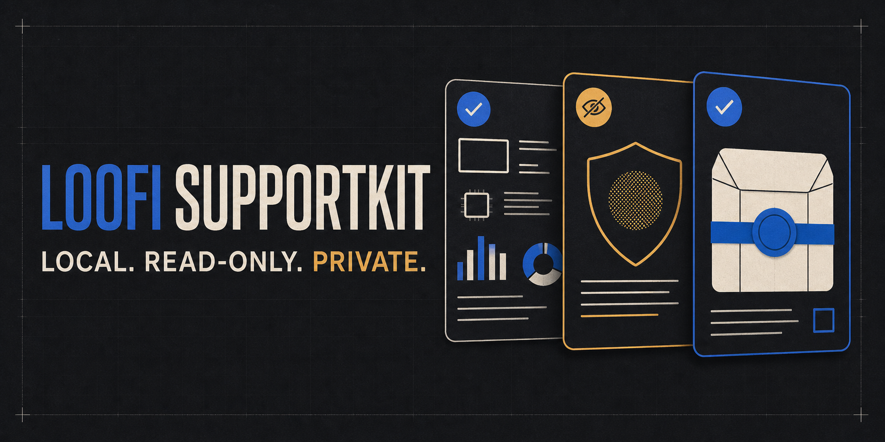

# Loofi SupportKit



Loofi SupportKit is a local-first desktop diagnostics application for Windows 11 x64 and Fedora KDE 44 x64. It collects bounded, read-only system evidence, evaluates deterministic rules, lets the user review privacy transformations, and exports a portable support case.

The project contains a complete first usable vertical slice. It does not repair systems, require an account, upload data, run a remote agent, or use AI in its trusted diagnostic core.


## What works

- Category-driven diagnostic scans with fail-soft collectors.
- Deterministic findings with stable rule IDs, severity, confidence, evidence, impact, and next steps.
- Structured redaction of common identifiers and credential-like content.
- Offline HTML, JSON, and deterministic ZIP support-case exports with checksums.
- Atomic local case persistence and reopen/delete history actions.
- A Tauri 2 + React desktop workflow with a browser demo mode for UI tests.

## Quick start

Prerequisites: Node.js 22.12+, Rust 1.85+, and the [Tauri system dependencies](https://v2.tauri.app/start/prerequisites/) for your platform.

```bash
just setup
just dev
```

Run all repository checks:

```bash
just check
```

The browser-only UI can be started with `npm run dev`. It uses synthetic fixture evidence and never probes the host. The Tauri app uses the Rust diagnostic backend.

## Install

- Fedora KDE 44 x64: install from [Fedora COPR](https://copr.fedorainfracloud.org/coprs/loofitheboss/loofi-supportkit/) or download the RPM/AppImage from the [latest GitHub release](https://github.com/loofiboss-bit/loofi-supportkit/releases/latest).
- Windows 11 x64: download the NSIS installer or portable executable from the latest GitHub release. These initial Windows artifacts are unsigned; review the published SHA-256 checksums before running them.

See the [installation guide](docs/INSTALLATION.md) and [illustrated user guide](docs/USER_GUIDE.md) for step-by-step instructions.

## Safety boundary

Collectors never use a shell. Every process is selected from a reviewed allowlist, receives a fixed argument vector, has a timeout, and returns size-limited output plus structured status. The application runs without elevation. Exports are redacted copies; raw collection data remains inside the scan pipeline and is not written to exported files.

Read [SECURITY.md](SECURITY.md), [PRIVACY.md](PRIVACY.md), and [docs/THREAT_MODEL.md](docs/THREAT_MODEL.md) before extending collectors.

## Documentation

- [Product specification](docs/PRODUCT_SPEC.md)
- [Architecture](ARCHITECTURE.md)
- [Implementation plan and progress](docs/IMPLEMENTATION_PLAN.md)
- [Support-case format](docs/SUPPORT_CASE_FORMAT.md)
- [Rule authoring](docs/RULE_AUTHORING.md)
- [User guide](docs/USER_GUIDE.md)
- [Installation guide](docs/INSTALLATION.md)
- [Release notes](docs/releases/0.1.0.md)
- [Developer setup](docs/DEVELOPMENT.md)
- [Packaging](packaging/README.md)

## License

MIT. See [LICENSE](LICENSE).
