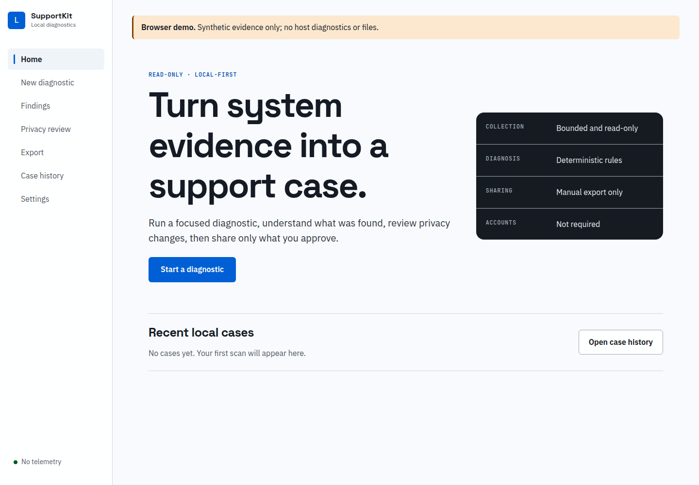
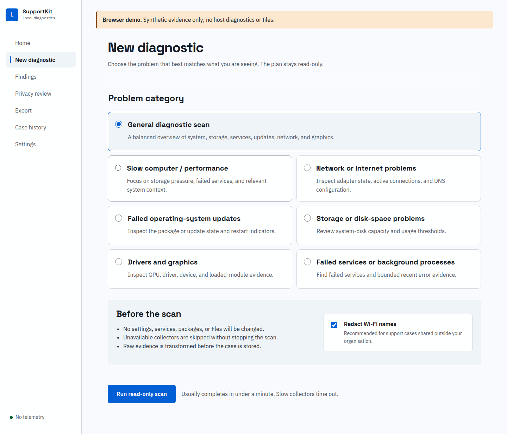
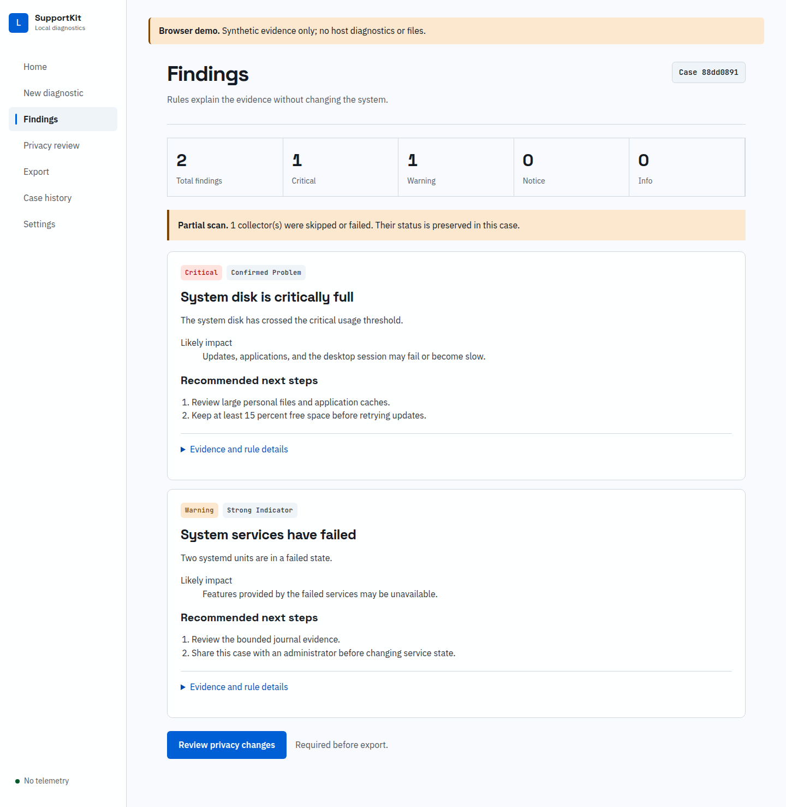
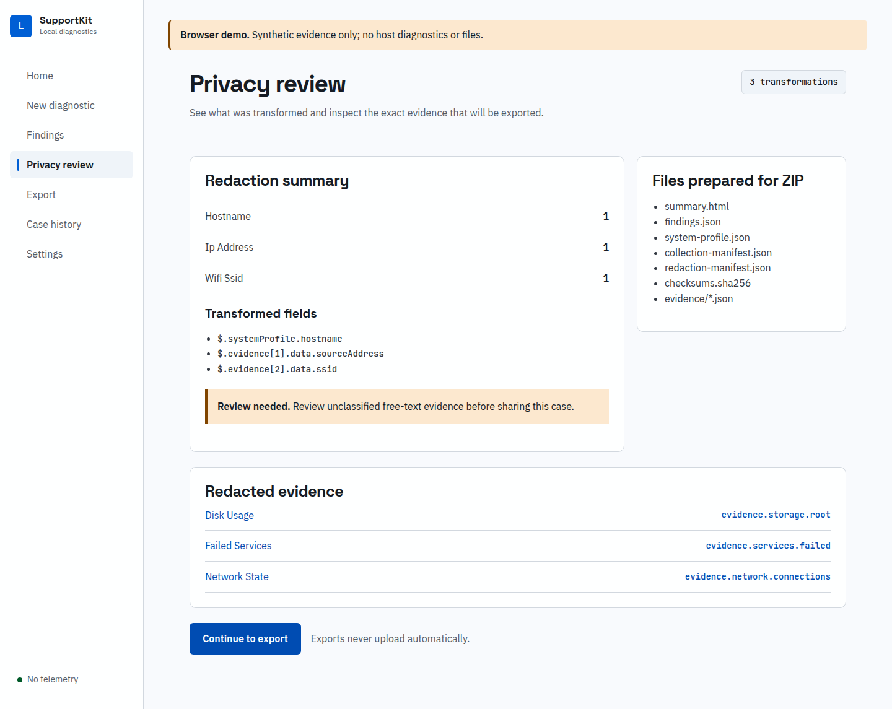
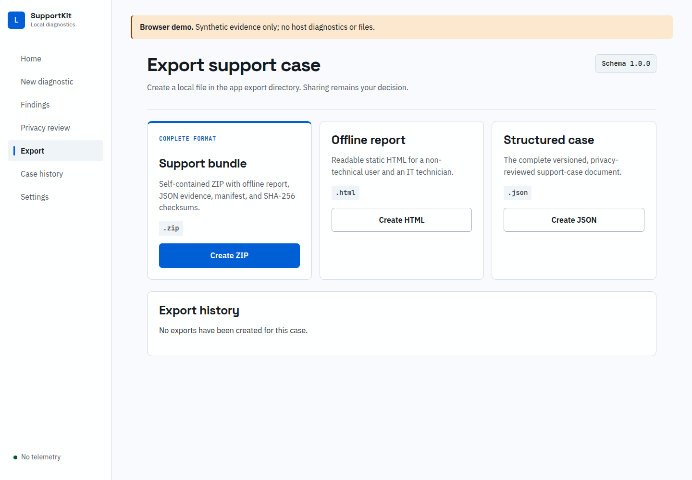
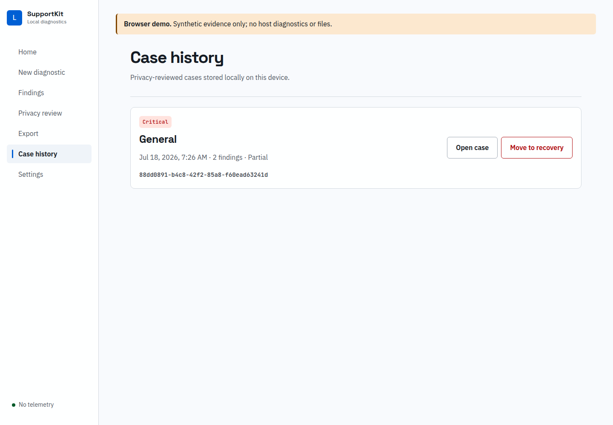

# User guide

Loofi SupportKit keeps the diagnostic workflow on your computer. A typical session takes you from a problem category to a privacy-reviewed support bundle without changing system settings.

## Before you start

Install the application using the [Fedora or Windows instructions](INSTALLATION.md). Close applications that show sensitive content, and decide where you want to save the exported support case. Diagnostics do not require administrator access.

## Run a diagnostic

1. Open Loofi SupportKit and select **New diagnostic**.
2. Choose the category closest to the problem. Use **General diagnostic scan** when the cause is unclear.
3. Keep Wi-Fi-name redaction enabled unless the network name is essential to the support request.
4. Select **Run read-only scan**. Unavailable collectors are recorded and skipped; they do not make the whole case fail.

The scan reads system state only. It does not install packages, restart services, change settings, upload evidence, or request administrator access.

## Read the result

Each finding states its severity, confidence, supporting evidence, likely impact, and safe next steps. A partial scan means at least one collector was unavailable, failed, or timed out. Treat missing evidence as unknown, not healthy.

Open **Evidence references** when a technician needs the source record behind a finding. The evidence identifier is stable inside the exported case, so it can be matched against the JSON and ZIP contents.

## Review privacy changes

Open **Privacy review** before exporting. It shows each redaction category, transformed JSON path, review warning, and the exact redacted evidence that will leave the application. Raw collection data is not saved to the case store.

Review remaining free-text warnings yourself. Automated redaction reduces common identifiers and credential-like values, but it cannot guarantee that every unusual personal value has been classified.

## Export and share

- **ZIP** is the preferred support bundle. It includes a static HTML summary, structured JSON, evidence files, manifests, and SHA-256 checksums.
- **HTML** is an offline, script-free report for reading in a browser.
- **JSON** is the complete versioned case for tools and long-term storage.

Use ZIP for a normal support request. Use HTML when the recipient only needs to read the report, and JSON when a technician or tool needs the full structured case.

Exports are written locally and are never uploaded automatically. Share the resulting file using a channel you trust.

## Reopen or remove a case

Use **Case history** to reopen a redacted local case. **Move to recovery** removes it from active history and moves the case document into the app recovery directory; existing exports are unchanged. The exact data and export paths are shown under **Settings**.

## Troubleshooting the application

- **A collector was skipped:** open the scan summary. Missing platform tools and unsupported host versions are reported as unavailable instead of being treated as healthy.
- **The scan is partial:** export the case only if the visible evidence is still useful. Tell the recipient which collectors did not complete.
- **An export cannot be found:** open **Settings** to see the application data and export directories.
- **Windows warns about the download:** the first release is unsigned. Verify `SHA256SUMS.txt` as described in the installation guide before using the SmartScreen override.
- **Fedora does not receive updates:** confirm that the COPR is enabled with `dnf copr list`, then run `sudo dnf upgrade --refresh`.

## Current limits

- Cancellation is represented in the case format, but active process cancellation is not yet exposed. Every collector has a fixed timeout.
- Windows live collectors and installers require Windows 11 x64 validation.
- Loofi SupportKit does not provide repair actions or claim Flatpak support.
